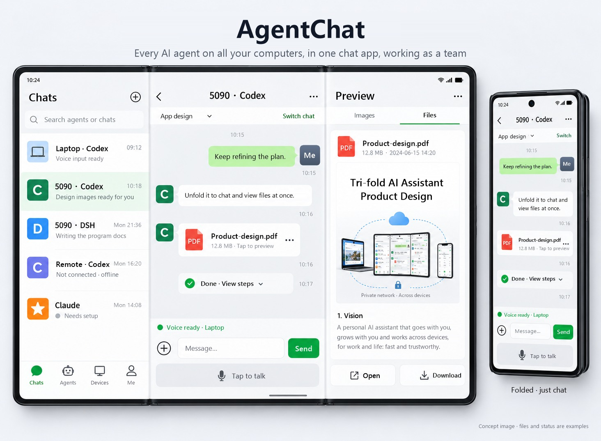

# AgentChat

English | [中文](README.zh-CN.md)

**Every AI agent on all your computers, in one chat app on your phone.**

Codex, Claude Code, OpenCode, Goose… running on several computers at home and at work. AgentChat puts them in your phone's contact list like friends: see what each one is doing, message them to get work done, approve their commands with a tap. They can also hand work to each other, and report back when they're done.

   



> **Heads-up: the interface is in Chinese for now.** The phone app, the desktop window and the notes AgentChat gives each agent are all Chinese today. An English interface is on the wish list, and help is very welcome (see [Get involved](#get-involved)).

---

## Sound familiar?

- You leave an agent on a big task, step away, and come back to find it **stuck on one approval prompt all afternoon**.
- Claude Code on your work laptop finished the code, and you want Codex on your home PC to test it, so you **copy and paste between them by hand**.
- Four agents on three computers: **who's busy, who's done, who hit an error?** You check them one machine at a time.

AgentChat is built for exactly these moments.

## Two big ideas

### 1. Run your AI like you text your friends

Open your phone and every agent on every computer is in your contacts. Tap one and you're in a familiar chat:

- **The same conversation everywhere.** What you send from the phone shows up in that agent's window on the computer, just as if you typed it there yourself; what happens on the computer shows up on your phone as it happens.
- **No more stalled approvals.** When an agent wants to run a command, your phone gets a card that says in plain words what it wants to do and whether it's risky. Tap Allow or Deny.
- **Notifications follow you.** Sitting at the computer, alerts pop up in its corner and your phone stays quiet. Walk away, and they come to your phone.
- **Agents are teammates.** Give them nicknames and avatars, or mute the noisy ones.

### 2. Turn every agent into one team

Agents on different computers, from different makers, can talk to each other for the first time:

- **Delegate in one sentence.** Tell Claude Code "have Codex on the 5090 run the tests", and it hands the task over.
- **Reports come back on their own.** When the other agent finishes, its result lands back in the conversation that asked. No waiting around.
- **Files travel along.** Files the task needs, and files the other agent produces, are copied between the computers for you.
- **You see all of it.** The phone's workbench strings each collaboration together: who handed what to whom, how far it got, what came of it. Your word always comes first, and you can stop anything at any time.

## How it connects

```
   Phone (AgentChat app)
          │
     Tailscale encrypted network (yours, free)
          │
   Hub (one computer that stays on)
     ┌────┴─────┬──────────┐
  Computer A  Computer B  Computer C
  Claude Code  Codex      OpenCode / Goose
```

- **No third-party servers.** Your phone and computers join your own private network with [Tailscale](https://tailscale.com); conversations are stored only on your own computers.
- **Official interfaces only.** Agents are connected through the interfaces their makers provide: nothing is cracked or patched. Each agent's account, model and keys stay in its own app.
- **One program on every computer.** One computer that stays on acts as the hub, linking your phone and the other computers; you can move the hub to another computer at any time.

## Set up in three steps

### Step 1: install on the computer that stays on

1. Download the latest `AgentChat-<version>.zip` from [Releases](../../releases), unzip it, and double-click **Setup.cmd**.
   - If Windows says "Windows protected your PC", click "More info" → "Run anyway". AgentChat is open source and has no paid code-signing certificate, hence the warning.
2. The AgentChat window opens and walks you through Tailscale: install it, sign in through your browser (Google and Microsoft accounts work), and click "Enable" once on the Tailscale website to turn on HTTPS. Each step moves on by itself when it's done.
3. When the window asks whether this computer usually stays on, answer yes. It becomes the hub.

Afterwards there's an AgentChat icon on the desktop, and it starts with Windows. The dot in the bottom-right corner: green means all good, orange means something needs you, grey means paused.

### Step 2: your other computers

Double-click Setup.cmd the same way and sign in to the **same** Tailscale account. It finds the hub and joins on its own; nothing to fill in.

### Step 3: your phone

1. Install Tailscale on the phone (search "Tailscale" in the app store) and sign in to the **same** account.
2. In the hub's AgentChat window, click "Add phone → Show QR code" and scan it with the phone's camera.
   - No AgentChat app yet? The page that opens walks you through installing it, then pairs automatically.

### Then: add your agents as friends

Install an agent on any of your computers, open it and sign in once. Within two minutes it shows up under "Contacts → New friends" on your phone. Tap "Add".

| Agent | Download |
|---|---|
| Codex | https://developers.openai.com/codex |
| Claude Code (in the Claude desktop app) | https://claude.com/download |
| OpenCode | https://opencode.ai/download |
| Goose | https://block.github.io/goose/ |

## FAQ

**Does it cost anything?** AgentChat is free, and so is Tailscale's personal plan. Whatever the agents themselves cost stays the same.

**Is it safe?** Phone and computers talk over your own encrypted Tailscale network, which nobody else can join. AgentChat goes through no outside server and collects no data. All the code is open, so you can check for yourself.

**iPhone?** Open the web version in the browser and "Add to Home Screen". It works, but without background notifications. The app is Android only for now.

**The phone can't connect?** The app tells you whether Tailscale is missing, switched off, or stopped by the phone's battery saver, with a button for each. Battery saving is the usual culprit: set Tailscale's battery setting to "Unrestricted".

**Move the hub to another computer?** In the current hub's window: Settings → Hub "Change" → pick the computer, then "Hand over". The other computers and your phone follow, and the conversation history moves along.

**Updates?** The hub checks for a new version once a day. When there is one, an "Update" button shows up in the window and on the phone; one tap, and the other computers follow automatically.

**Need help with a problem?** Right-click the dot in the bottom-right corner and choose "Export diagnostics". A diagnostics package appears on your desktop to send to whoever is helping you. Passwords and keys are already removed from it.

**Uninstall?** Start menu → AgentChat → Uninstall AgentChat, or uninstall it under Settings → Apps. Everything AgentChat added to each agent's settings is taken out too; you're asked first whether to keep your conversation history.

## Get involved

Your agent isn't on the list? Bring it in. If it has an open interface, an adapter is usually all it takes. An English interface would be a great contribution too.

The developer docs are in Chinese for now (a translation tool reads them well):

- Why AgentChat is designed this way, and what every change is checked against: [docs/设计原则.md](docs/设计原则.md)
- Connecting a new agent: [docs/接入新Agent.md](docs/接入新Agent.md)
- Contributing changes: [CONTRIBUTING.md](CONTRIBUTING.md)
- Code structure, commands, testing: [docs/开发说明.md](docs/开发说明.md)

If AgentChat is useful to you, a ⭐ Star helps more people find it.

## License

[MIT](LICENSE)
