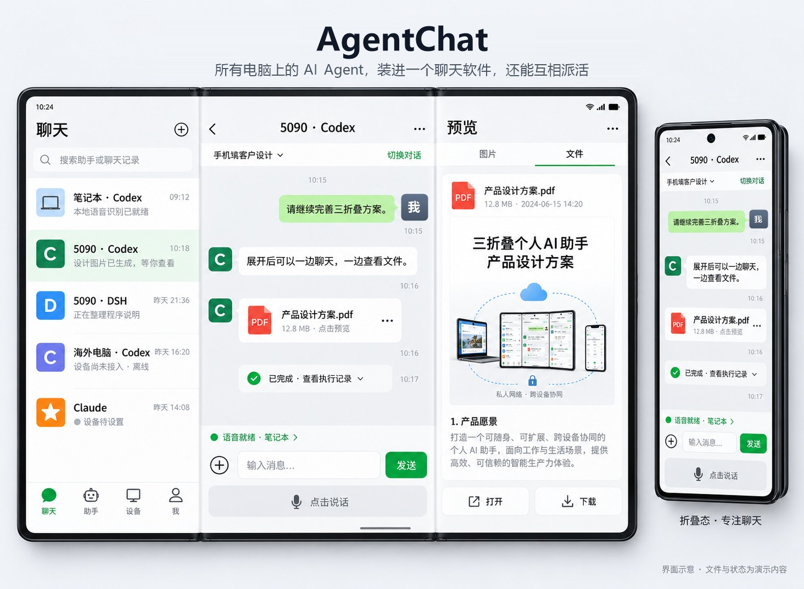

# AgentChat

[English](README.md) | 中文

**把你所有电脑上的 AI Agent，装进手机里的一个聊天软件。**

https://github.com/user-attachments/assets/8064f4db-f103-4ce8-91ff-b3267ee4fb08

（宣传片，英文配音，33 秒）

Codex、Claude Code、OpenCode、Goose、DSH（DeepSeek Harness）……分散在家里、公司的好几台电脑上。AgentChat 让它们像好友一样出现在你的手机通讯录里：随时看它们在干什么、发消息让它们干活、替它们点审批。它们之间也能互相派活，做完自动向你汇报。

   



---

## 你是不是也这样？

- 让 Agent 跑一个大任务，人一走开，回来发现它**卡在一个审批上等了一下午**。
- 公司电脑上的 Claude Code 写完了代码，想让家里那台电脑上的 Codex 帮忙测一下，只能**自己来回复制粘贴**。
- 四个 Agent 开在三台电脑上，**谁在忙、谁做完了、谁出错了**，只能一台一台去看。

AgentChat 就是为这些时刻做的。

## 两个亮点

### 1. 像聊微信一样指挥 AI

打开手机，通讯录里是你每台电脑上的每个 Agent。点进去就是熟悉的聊天界面：

- **对话和电脑上一模一样。** 你在手机上发的话，会出现在电脑上那个 Agent 的窗口里，就像你坐在电脑前亲手打的；电脑上的进展，手机上实时看到。
- **审批不再卡住。** Agent 要执行命令时，手机上弹出一张卡片，用大白话告诉你它想干什么、有没有风险，点一下「允许」或「拒绝」就行。
- **提醒会跟着你。** 人坐在电脑前时，提醒弹在电脑右下角，手机安安静静；人一走开，提醒就到手机上。
- **每个 Agent 都是你的同事。** 可以给它们改昵称、换头像，嫌吵就单独开「免打扰」。

### 2. 让所有 Agent 连成一个团队

不同电脑、不同厂家的 Agent，第一次能直接对话：

- **一句话派活。** 对 Claude Code 说「让 5090 上的 Codex 把测试跑一遍」，它就会把任务交过去。
- **做完自动汇报。** 对方做完，结果会自动回到发起的那个对话里，不用一直盯着等。
- **文件跟着走。** 需要的文件、对方做出来的文件，会自动在两台电脑之间传好。
- **整个过程你都看得见。** 手机的工作台按任务把来回的协作串成一条线：谁派给了谁、做到哪一步、结果是什么。你的指令永远优先，可以随时叫停。

## 它是怎么连起来的

```
   手机（AgentChat App）
          │
     Tailscale 加密网络（你自己的，免费）
          │
   主电脑（一台常开的电脑）
     ┌────┴─────┬──────────┐
  电脑 A      电脑 B      电脑 C
  Claude Code  Codex      OpenCode / Goose / DSH
```

- **不经过任何第三方服务器。** 手机和电脑之间用 [Tailscale](https://tailscale.com) 连成你自己的私有网络，对话记录只存在你自己的电脑上。
- **只用各家官方的接口**接入 Agent，不破解、不改它们的程序。各家的账号、模型和密钥，仍然在它们自己的软件里设置。
- **所有电脑装同一个程序。** 其中一台常开的电脑当「主电脑」，负责连接手机和其他电脑；随时可以换成另一台。

## 三步装好

### 第一步：在常开的那台电脑上安装

1. 到 [Releases](../../releases) 下载最新的 `AgentChat-<版本>.zip`，解压，双击里面的 **Setup.cmd**。
   - 如果 Windows 提示「Windows 已保护你的电脑」，点「更多信息」→「仍要运行」。AgentChat 是开源程序，没有购买代码签名证书，所以会有这个提示。
2. AgentChat 的窗口会自动打开，一步步带你装好 Tailscale：下载安装、用浏览器登录（Google、微软账号都行）、在 Tailscale 网页上点一次「Enable」打开 HTTPS。每一步做完，窗口都会自动进入下一步。
3. 窗口问「这台电脑平时开着吗？」时，点「是」，它就成了主电脑。

装好后桌面上有 AgentChat 图标，开机自动启动。右下角的圆点：绿色是正常，橙色表示有事要你处理，灰色表示已暂停。

### 第二步：其他电脑

同样双击 Setup.cmd，登录**同一个** Tailscale 账号。它会自动找到主电脑并加入，什么都不用填。

### 第三步：手机

1. 手机上安装 Tailscale（应用商店搜「Tailscale」），登录和电脑**同一个**账号。
2. 在主电脑的 AgentChat 窗口里点「添加手机 → 显示二维码」，用手机相机扫一下。
   - 还没装 AgentChat App 的话，打开的网页会一步步教你安装，装好就自动配对。

### 然后：把 Agent 加为好友

在任意一台电脑上装好 Agent，打开并登录一次。2 分钟内，手机「通讯录 → 新的朋友」里就会出现它，点「添加」。

| Agent | 下载 |
|---|---|
| Codex | https://developers.openai.com/codex |
| Claude Code（在 Claude 桌面版里） | https://claude.com/download |
| OpenCode | https://opencode.ai/download |
| Goose | https://block.github.io/goose/ |
| DSH（DeepSeek Harness） | https://github.com/deepseek-ai/deepseek-harness（AgentChat 会给 DSH 装一个小插件，要重启一次 DSH；DSH 的审批目前还要在 DSH 窗口里点） |

## 常见问题

**要花钱吗？** AgentChat 和 Tailscale 个人版都免费。各家 Agent 本身怎么收费，照旧。

**安全吗？** 手机和电脑之间走的是你自己的 Tailscale 加密网络，别人连不进来；AgentChat 不经过任何外部服务器，也不收集任何数据。代码全部开源，可以自己看。

**iPhone 能用吗？** 可以用浏览器打开网页版，再「添加到主屏幕」，但没有后台提醒。App 目前只有安卓版。

**手机连不上？** App 会告诉你是 Tailscale 没装、没打开，还是被手机省电功能关掉了，并给出对应的按钮。最常见的是省电：把 Tailscale 的电池设置改成「不受限制」。

**想换一台电脑当主电脑？** 在当前主电脑的窗口里：设置 → 主电脑「更换」→ 选目标电脑，点「移交给它」。其他电脑和手机会自动跟过去，对话记录也一起搬过去。

**怎么更新？** 主电脑每天检查一次新版本。有新版本时，窗口和手机上会出现「更新」按钮，点一下就好，其他电脑会自动跟着更新。

**遇到问题想找人帮忙？** 右键右下角的圆点图标，选「导出诊断信息」，桌面上会出现一个诊断包，把它发给帮你看问题的人。里面的密码和密钥已经去掉了。

**怎么卸载？** 开始菜单 → AgentChat → 卸载 AgentChat，或者在「设置 → 应用」里卸载。AgentChat 加进各家 Agent 的设置会一并撤掉；对话记录要不要保留，会先问你。

## 一起来做

你用的 Agent 不在上面的列表里？欢迎接进来，只要它有开放的接口，通常写一个适配器就够了。

- 为什么这样设计、开发时对照什么：[docs/设计原则.md](docs/设计原则.md)
- 接入一个新的 Agent：[docs/接入新Agent.md](docs/接入新Agent.md)
- 参与开发、提交改动：[CONTRIBUTING.md](CONTRIBUTING.md)
- 程序结构、常用命令、怎么测试：[docs/开发说明.md](docs/开发说明.md)

觉得有用的话，点个 ⭐ Star，让更多人看到。

## 许可

[MIT](LICENSE)
